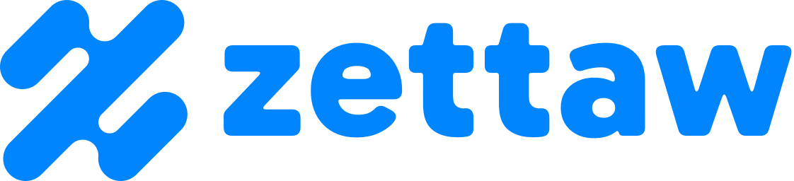

# Zettaw — Logo Kit

Logo kit for **zettaw.com**, the Zettaw parent brand.

Base URL: `https://cdn.zettaw.net/com/`



## The mark

Three parallel 45° capsules joined by two rounded bridges, forming a **Z** that is point-symmetric (looks the same
rotated 180°). One stroke weight, round ends everywhere, no corners — a single continuous flow.

Construction (256 grid): stroke width `2r = 42`, all capsule ends radius `r = 21`, slot ends `r/2`, bridge notches
`0.7r`. The drawing is one path, built from arcs and 45° lines only.

## Logo versions

| Version | File | Use |
|---|---|---|
| **Horizontal** (primary) | `svg/zettaw-horizontal.svg` | Default everywhere: headers, docs, sign-in, slides |
| Stacked | `svg/zettaw-stacked.svg` | Square-ish spaces: splash screens, posters, merch |
| Symbol | `svg/zettaw-symbol.svg` | Small or square spaces: avatars, favicons, app icons |
| Wordmark | `svg/zettaw-wordmark.svg` | When the symbol already appears nearby |

Each lockup comes in `-gradient` (gradient symbol, flat wordmark), `-white` and `-black`; the wordmark in flat, `-white`
and `-black`. PNG exports at 600 · 1200 · 2400 px wide in `png/`.

## Wordmark

`zettaw` in lowercase, drawn from **Gabarito ExtraBold** (SIL Open Font License) with every corner rounded to match the
symbol's round ends. It is artwork, not live text — always use the files, never retype it.

Lockup proportions (symbol height = `H`): wordmark x-height = `0.5 H`, gap between symbol and wordmark = `0.2 H`.
Stacked: wordmark width = `1.9 ×` symbol width, gap = `0.16 H`.

For headings and UI text, use plain **Gabarito** (Bold/ExtraBold) from Google Fonts; body text can use Gabarito Regular
or the system UI font.

## Files

### Symbol — `svg/` (masters) and `png/` (128 · 256 · 512 · 1024 · 2048 px, transparent)

| File | Use |
|---|---|
| `zettaw-symbol.svg` | **Primary.** Flat blue, for light backgrounds |
| `zettaw-symbol-gradient.svg` | Expressive version: hero areas, splash screens, dark UI, marketing |
| `zettaw-symbol-white.svg` | Reversed, on blue, dark or photo backgrounds (slightly thinned to offset glow) |
| `zettaw-symbol-black.svg` | One-colour: print, stamps, engraving, fax/B&W |
| `zettaw-symbol-deep.svg` | One-colour in deep blue, when the primary blue lacks contrast on light tints |
| `zettaw-symbol-small.svg` | **Small-size cut** (wider slots, softer notches) — use below 32 px |

### Tiles — `svg/` and `png/` (512 · 1024 px)

| File | Use |
|---|---|
| `zettaw-app-icon.svg` | App icon / store listing, white mark on blue |
| `zettaw-app-icon-dark.svg` | Dark-mode app icon, gradient mark on `#071226` |
| `zettaw-avatar.svg` | Social avatars (square, full-bleed — platforms crop to circle) |

### Web — `web/`

`favicon.ico` (16/32/48), `favicon.svg`, `favicon-16/32/48.png`, `apple-touch-icon.png` (180), `icon-192.png`,
`icon-512.png`, `maskable-512.png`, `site.webmanifest`. All built from the small-size cut.

```html
<link rel="icon" href="https://cdn.zettaw.net/com/web/favicon.ico" sizes="48x48">
<link rel="icon" href="https://cdn.zettaw.net/com/web/favicon.svg" type="image/svg+xml">
<link rel="apple-touch-icon" href="https://cdn.zettaw.net/com/web/apple-touch-icon.png">
<meta name="theme-color" content="#0085FC">
```

For a PWA, copy `web/site.webmanifest` and the icons to your own origin (manifests should be same-origin).

## Colour

| Name | HEX | RGB | CMYK (approx.) | Role |
|---|---|---|---|---|
| Zettaw Blue | `#0085FC` | 0 133 252 | 100 47 0 1 | Primary — flat logo, tiles, accents |
| Sky | `#18C0FC` | 24 192 252 | 90 24 0 1 | Gradient highlight only |
| Deep Blue | `#0048FE` | 0 72 254 | 100 72 0 0 | Gradient shadow, one-colour alt, text-safe blue |
| Ink | `#071226` | 7 18 38 | 82 53 0 85 | Dark backgrounds |
| White | `#FFFFFF` | 255 255 255 | 0 0 0 0 | Reversed logo, light backgrounds |

Gradient: linear, top-right → bottom-left, `#18C0FC` 0% · `#0085FC` 55% · `#0048FE` 100%.

Accessibility: white on `#0085FC` is 3.6:1 — OK for large text and UI icons, not body text. Deep Blue `#0048FE` on
white is 6.3:1 (AA for all text).

Sub-brand **zettaw.ai** uses the same symbol in green ([`/ai/`](../ai/)); the colour is what tells the two apart.

## Clear space

Keep free space around any logo version equal to **one stroke width** of the symbol (≈ ¼ of the symbol's height)
on every side.
Scales with the logo.

## Minimum size

| Version | Screen | Print |
|---|---|---|
| Horizontal lockup | 96 px wide | 25 mm wide |
| Stacked lockup | 64 px wide | 18 mm wide |
| `symbol` / `gradient` / `white` | 32 px | 8 mm |
| `symbol-small` | 16 px | 5 mm |

## Approved backgrounds

- Blue or gradient symbol on white / very light neutrals
- Gradient symbol on Ink `#071226` or other near-black
- White symbol on Blue, Deep Blue, Ink, or calm areas of photos
- Black symbol for one-colour print

## Don't

- Stretch, squash, rotate, mirror, or skew the symbol
- Recolour outside the palette, or use the gradient below 32 px
- Add outlines, shadows, glows, bevels, or extra effects
- Place on busy backgrounds without a solid tile behind it
- Redraw or trace the mark, or retype the wordmark — always use these files
- Change the size or spacing between symbol and wordmark
- Use the symbol in green (that is zettaw.ai)

## Notes

- Masters are pure vector paths: no text, rasters, filters, or masks.
- Trademark clearance has not been checked; run a professional search before registering.
