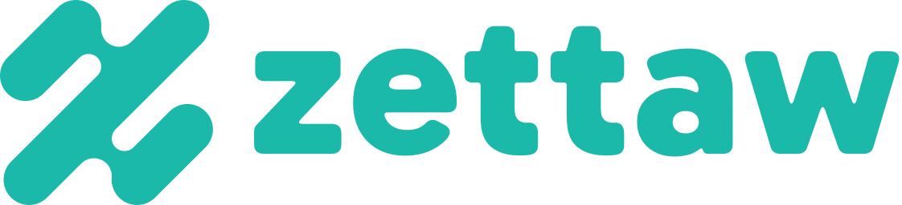
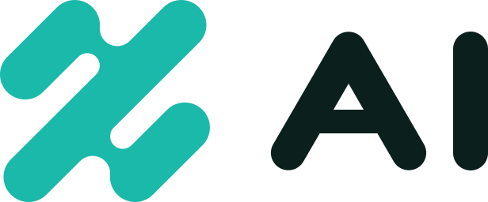
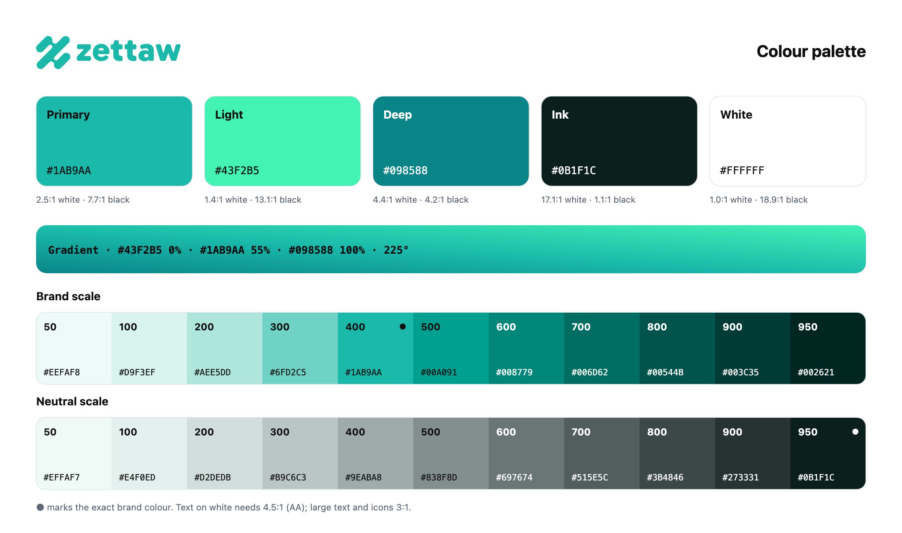

# Zettaw AI — Logo Kit

Logo kit for **zettaw.ai**, the AI sub-brand of Zettaw.

Base URL: `https://cdn.zettaw.net/logo/ai/`



## The mark

Three parallel 45° capsules joined by two rounded bridges, forming a **Z** that is point-symmetric (looks the same
rotated 180°). One stroke weight, round ends everywhere, no corners — a single continuous flow.

Construction (256 grid): stroke width `2r = 42`, all capsule ends radius `r = 21`, slot ends `r/2`, bridge notches
`0.7r`. The drawing is one path, built from arcs and 45° lines only.

## Logo versions

| Version | File | Use |
|---|---|---|
| **Horizontal** (primary) | `svg/zettaw-ai-horizontal.svg` | Default everywhere: headers, docs, sign-in, slides |
| Stacked | `svg/zettaw-ai-stacked.svg` | Square-ish spaces: splash screens, posters, merch |
| Symbol | `svg/zettaw-ai-symbol.svg` | Small or square spaces: avatars, favicons, app icons |
| Wordmark | `svg/zettaw-ai-wordmark.svg` | When the symbol already appears nearby |
| **Product lockup** (Z + `AI`) | `svg/zettaw-ai-lockup.svg` | Compact product name, Apple TV / Apple Music style: app headers, nav bars, store badges, short placements |

Each lockup comes in `-gradient` (gradient symbol, flat wordmark), `-white` and `-black`; the wordmark in flat, `-white`
and `-black`. PNG exports at 600 · 1200 · 2400 px wide in `png/`.

## Product lockup



The symbol followed by `AI`, in the style of Apple TV / Apple Music. Use it where the name is already clear from context
and space is tight; use the horizontal lockup when people may not know the brand yet.

`AI` is custom artwork in the symbol's language: one stroke weight (`44` on the 256 grid), round ends, legs of the `A`
at exactly 60°. Cap height matches the symbol's main body; gap between symbol and `AI` = `0.2 H`. Never retype it.

| File | Symbol | `AI` | Use |
|---|---|---|---|
| `zettaw-ai-lockup.svg` | Green | Ink `#0B1F1C` | **Primary**, on white / light backgrounds |
| `zettaw-ai-lockup-green.svg` | Green | Green | One-colour green, on white |
| `zettaw-ai-lockup-gradient.svg` | Gradient | Ink | Hero areas and marketing on light backgrounds |
| `zettaw-ai-lockup-white.svg` | White | White | Reversed, on green, Ink or photos (slightly thinned) |
| `zettaw-ai-lockup-black.svg` | Black | Black | One-colour print |

PNG exports at 600 · 1200 · 2400 px wide in `png/` (`zettaw-ai-lockup[-variant]-<width>.png`). Minimum size: 64 px wide.

```html

```

## Wordmark

`zettaw` in lowercase, drawn from **Gabarito ExtraBold** (SIL Open Font License) with every corner rounded to match the
symbol's round ends. It is artwork, not live text — always use the files, never retype it.

Lockup proportions (symbol height = `H`): wordmark x-height = `0.5 H`, gap between symbol and wordmark = `0.2 H`.
Stacked: wordmark width = `1.9 ×` symbol width, gap = `0.16 H`.

For headings and UI text, use plain **Gabarito** (Bold/ExtraBold) from Google Fonts; body text can use Gabarito Regular
or the system UI font.

## Files

### Symbol — `svg/` (masters) and `png/` (128 · 256 · 512 · 1024 · 2048 px, transparent)

| File | Use |
|---|---|
| `zettaw-ai-symbol.svg` | **Primary.** Flat green, for light backgrounds |
| `zettaw-ai-symbol-gradient.svg` | Expressive version: hero areas, splash screens, dark UI, marketing |
| `zettaw-ai-symbol-white.svg` | Reversed, on green, dark or photo backgrounds (slightly thinned to offset glow) |
| `zettaw-ai-symbol-black.svg` | One-colour: print, stamps, engraving, fax/B&W |
| `zettaw-ai-symbol-deep.svg` | One-colour in deep teal, when green lacks contrast on light tints |
| `zettaw-ai-symbol-small.svg` | **Small-size cut** (wider slots, softer notches) — use below 32 px |

### Tiles — `svg/` and `png/` (512 · 1024 px)

| File | Use |
|---|---|
| `zettaw-ai-app-icon.svg` | App icon / store listing, white mark on green |
| `zettaw-ai-app-icon-dark.svg` | Dark-mode app icon, gradient mark on `#0B1F1C` |
| `zettaw-ai-avatar.svg` | Social avatars (square, full-bleed — platforms crop to circle) |

### Web — `web/`

`favicon.ico` (16/32/48), `favicon.svg`, `favicon-16/32/48.png`, `apple-touch-icon.png` (180), `icon-192.png`,
`icon-512.png`, `maskable-512.png`, `site.webmanifest`. All built from the small-size cut.

```html
<link rel="icon" href="https://cdn.zettaw.net/logo/ai/web/favicon.ico" sizes="48x48">
<link rel="icon" href="https://cdn.zettaw.net/logo/ai/web/favicon.svg" type="image/svg+xml">
<link rel="apple-touch-icon" href="https://cdn.zettaw.net/logo/ai/web/apple-touch-icon.png">
<meta name="theme-color" content="#1AB9AA">
```

For a PWA, copy `web/site.webmanifest` and the icons to your own origin (manifests should be same-origin).

## Colour

| Name | HEX | RGB | CMYK (approx.) | Role |
|---|---|---|---|---|
| Zettaw AI Green | `#1AB9AA` | 26 185 170 | 86 0 8 27 | Primary — flat logo, tiles, accents |
| Mint | `#43F2B5` | 67 242 181 | 72 0 25 5 | Gradient highlight only |
| Deep Teal | `#098588` | 9 133 136 | 93 2 0 47 | Gradient shadow, one-colour alt, text-safe green |
| Ink | `#0B1F1C` | 11 31 28 | 65 0 10 88 | Dark backgrounds |
| White | `#FFFFFF` | 255 255 255 | 0 0 0 0 | Reversed logo, light backgrounds |

Gradient: linear, top-right → bottom-left, `#43F2B5` 0% · `#1AB9AA` 55% · `#098588` 100%.

Accessibility: white on `#1AB9AA` is ~2.5:1 — fine for the logo (logos are exempt), **not** for text or UI icons.
For text on white or white text on green, use Deep Teal `#098588` (4.5:1 — AA large text; borderline for body text) or Ink.

Parent brand **zettaw.com** uses the same symbol in blue ([`/logo/com/`](../com/)); the colour is what tells the two apart. Finance line: gold, [`/logo/finance/`](../finance/).

## Palette



Full UI palette built from the brand colours (OKLCH, same hue throughout). The exact primary is step **400**.

**Brand scale**

| 50 | 100 | 200 | 300 | 400 | 500 | 600 | 700 | 800 | 900 | 950 |
|---|---|---|---|---|---|---|---|---|---|---|
| `#EEFAF8` | `#D9F3EF` | `#AEE5DD` | `#6FD2C5` | `#1AB9AA` | `#00A091` | `#008779` | `#006D62` | `#00544B` | `#003C35` | `#002621` |

**Neutral scale** (tinted toward the brand)

| 50 | 100 | 200 | 300 | 400 | 500 | 600 | 700 | 800 | 900 | 950 |
|---|---|---|---|---|---|---|---|---|---|---|
| `#EFFAF7` | `#E4F0ED` | `#D2DEDB` | `#B9C6C3` | `#9EABA8` | `#838F8D` | `#697674` | `#515E5C` | `#3B4846` | `#273331` | `#0B1F1C` |

### Palette files — `palette/`

| File | For |
|---|---|
| `palette.png` / `palette.svg` | Visual swatch sheet |
| `colors.css` | CSS variables: `var(--zettaw-ai-primary)`, `var(--zettaw-ai-400)`, `var(--zettaw-ai-neutral-900)`, `var(--zettaw-ai-gradient)` |
| `tailwind.css` | Tailwind CSS v4 `@theme`: `bg-zettaw-ai-400`, `text-zettaw-ai-neutral-900` |
| `colors.json` | Design tokens (W3C format) for Figma Tokens Studio / Style Dictionary |
| `colors.ase` | Adobe swatches (Illustrator, Photoshop, InDesign) |
| `colors.gpl` | GIMP / Inkscape / Krita palette |

```html
<link rel="stylesheet" href="https://cdn.zettaw.net/logo/ai/palette/colors.css">
```

## Clear space

Keep free space around any logo version equal to **one stroke width** of the symbol (≈ ¼ of the symbol's height)
on every side.
Scales with the logo.

## Minimum size

| Version | Screen | Print |
|---|---|---|
| Horizontal lockup | 96 px wide | 25 mm wide |
| Stacked lockup | 64 px wide | 18 mm wide |
| Product lockup | 64 px wide | 18 mm wide |
| `symbol` / `gradient` / `white` | 32 px | 8 mm |
| `symbol-small` | 16 px | 5 mm |

## Approved backgrounds

- Green or gradient symbol on white / very light neutrals
- Gradient symbol on Ink `#0B1F1C` or other near-black
- White symbol on Green, Deep Teal, Ink, or calm areas of photos
- Black symbol for one-colour print

## Don't

- Stretch, squash, rotate, mirror, or skew the symbol
- Recolour outside the palette, or use the gradient below 32 px
- Add outlines, shadows, glows, bevels, or extra effects
- Place on busy backgrounds without a solid tile behind it
- Redraw or trace the mark, or retype the wordmark — always use these files
- Change the size or spacing between symbol and wordmark
- Use the symbol in blue (that is zettaw.com)

## Notes

- Masters are pure vector paths: no text, rasters, filters, or masks.
- Trademark clearance has not been checked; run a professional search before registering.
