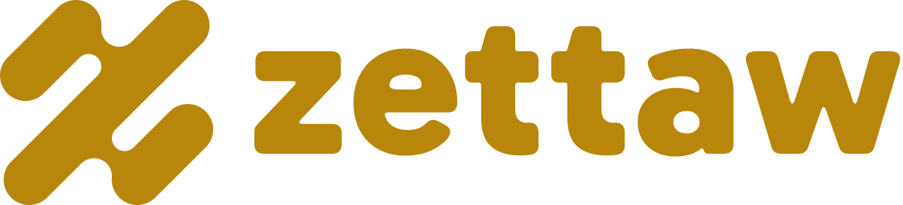

# Zettaw Finance — Logo Kit

Logo kit for **Zettaw Finance**, the finance / fintech line of Zettaw.

Base URL: `https://cdn.zettaw.net/logo/finance/`



## The mark

Three parallel 45° capsules joined by two rounded bridges, forming a **Z** that is point-symmetric (looks the same
rotated 180°). One stroke weight, round ends everywhere, no corners — a single continuous flow.

Construction (256 grid): stroke width `2r = 42`, all capsule ends radius `r = 21`, slot ends `r/2`, bridge notches
`0.7r`. The drawing is one path, built from arcs and 45° lines only.

## Logo versions

| Version | File | Use |
|---|---|---|
| **Horizontal** (primary) | `svg/zettaw-finance-horizontal.svg` | Default everywhere: headers, docs, sign-in, slides |
| Stacked | `svg/zettaw-finance-stacked.svg` | Square-ish spaces: splash screens, posters, merch |
| Symbol | `svg/zettaw-finance-symbol.svg` | Small or square spaces: avatars, favicons, app icons |
| Wordmark | `svg/zettaw-finance-wordmark.svg` | When the symbol already appears nearby |

Each lockup comes in `-gradient` (gradient symbol, flat wordmark), `-white` and `-black`; the wordmark in flat, `-white`
and `-black`. PNG exports at 600 · 1200 · 2400 px wide in `png/`.

## Wordmark

`zettaw` in lowercase, drawn from **Gabarito ExtraBold** (SIL Open Font License) with every corner rounded to match the
symbol's round ends. It is artwork, not live text — always use the files, never retype it.

Lockup proportions (symbol height = `H`): wordmark x-height = `0.5 H`, gap between symbol and wordmark = `0.2 H`.
Stacked: wordmark width = `1.9 ×` symbol width, gap = `0.16 H`.

For headings and UI text, use plain **Gabarito** (Bold/ExtraBold) from Google Fonts; body text can use Gabarito Regular
or the system UI font.

## Files

### Symbol — `svg/` (masters) and `png/` (128 · 256 · 512 · 1024 · 2048 px, transparent)

| File | Use |
|---|---|
| `zettaw-finance-symbol.svg` | **Primary.** Flat gold, for light backgrounds |
| `zettaw-finance-symbol-gradient.svg` | Expressive version: hero areas, splash screens, dark UI, marketing |
| `zettaw-finance-symbol-white.svg` | Reversed, on gold, dark or photo backgrounds (slightly thinned to offset glow) |
| `zettaw-finance-symbol-black.svg` | One-colour: print, stamps, engraving, fax/B&W |
| `zettaw-finance-symbol-deep.svg` | One-colour in deep bronze, for print or when gold lacks contrast on light tints |
| `zettaw-finance-symbol-small.svg` | **Small-size cut** (wider slots, softer notches) — use below 32 px |

### Tiles — `svg/` and `png/` (512 · 1024 px)

| File | Use |
|---|---|
| `zettaw-finance-app-icon.svg` | App icon / store listing, white mark on gold |
| `zettaw-finance-app-icon-dark.svg` | Dark-mode app icon, gradient mark on `#14110B` |
| `zettaw-finance-avatar.svg` | Social avatars (square, full-bleed — platforms crop to circle) |

### Web — `web/`

`favicon.ico` (16/32/48), `favicon.svg`, `favicon-16/32/48.png`, `apple-touch-icon.png` (180), `icon-192.png`,
`icon-512.png`, `maskable-512.png`, `site.webmanifest`. All built from the small-size cut.

```html
<link rel="icon" href="https://cdn.zettaw.net/logo/finance/web/favicon.ico" sizes="48x48">
<link rel="icon" href="https://cdn.zettaw.net/logo/finance/web/favicon.svg" type="image/svg+xml">
<link rel="apple-touch-icon" href="https://cdn.zettaw.net/logo/finance/web/apple-touch-icon.png">
<meta name="theme-color" content="#B8860B">
```

For a PWA, copy `web/site.webmanifest` and the icons to your own origin (manifests should be same-origin).

## Colour

| Name | HEX | RGB | CMYK (approx.) | Role |
|---|---|---|---|---|
| Zettaw Gold | `#B8860B` | 184 134 11 | 0 27 94 28 | Primary — flat logo, tiles, accents |
| Light Gold | `#F2D27A` | 242 210 122 | 0 13 50 5 | Gradient highlight only |
| Bronze | `#7A5510` | 122 85 16 | 0 30 87 52 | Gradient shadow, one-colour alt, text-safe gold |
| Ink | `#14110B` | 20 17 11 | 0 15 45 92 | Dark backgrounds — where gold looks best |
| White | `#FFFFFF` | 255 255 255 | 0 0 0 0 | Reversed logo, light backgrounds |

Gradient: linear, top-right → bottom-left, `#F2D27A` 0% · `#B8860B` 55% · `#7A5510` 100%.

**Gold works best on dark.** The gradient logo on Ink `#14110B` is the hero combination (gold on Ink 5.8:1). On white,
use the flat gold logo: it reads at 3.3:1, fine for a logo but not for body text. For gold text on white use Bronze
`#7A5510` (6.7:1, AA).

**Print:** for real metallic gold, print with a metallic ink (e.g. Pantone 871 C) or foil stamping; the CMYK values above
are a flat approximation. Use the `-deep` (bronze) or `-black` file as the foil/emboss master.

Same symbol as **zettaw.com** (blue, [`/logo/com/`](../com/)) and **zettaw.ai** (green, [`/logo/ai/`](../ai/)); colour
is what tells the lines apart.

## Clear space

Keep free space around any logo version equal to **one stroke width** of the symbol (≈ ¼ of the symbol's height)
on every side.
Scales with the logo.

## Minimum size

| Version | Screen | Print |
|---|---|---|
| Horizontal lockup | 96 px wide | 25 mm wide |
| Stacked lockup | 64 px wide | 18 mm wide |
| `symbol` / `gradient` / `white` | 32 px | 8 mm |
| `symbol-small` | 16 px | 5 mm |

## Approved backgrounds

- Gold or gradient symbol on white / very light neutrals
- Gradient symbol on Ink `#14110B` or other near-black
- White symbol on Gold, Bronze, Ink, or calm areas of photos
- Black symbol for one-colour print

## Don't

- Stretch, squash, rotate, mirror, or skew the symbol
- Recolour outside the palette, or use the gradient below 32 px
- Add outlines, shadows, glows, bevels, or extra effects
- Place on busy backgrounds without a solid tile behind it
- Redraw or trace the mark, or retype the wordmark — always use these files
- Change the size or spacing between symbol and wordmark
- Use the symbol in blue or green (those are zettaw.com and zettaw.ai)
- Fake metallic effects (bevels, shine, glitter) — the gradient file is the only approved "metal" look

## Notes

- Masters are pure vector paths: no text, rasters, filters, or masks.
- Trademark clearance has not been checked; run a professional search before registering.
